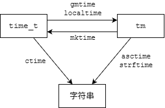
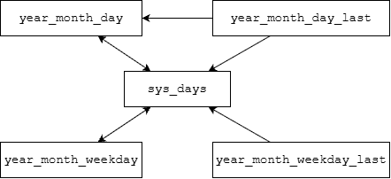
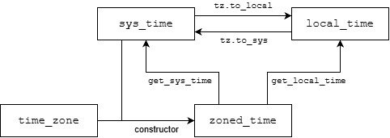

在C++中处理日期和时间有两种选择：继承自C语言的`<ctime>`，以及C++11引入的`<chrono>`。

本文将概述这两个日期时间库的用法，并重点介绍现代C++的日期、时间和时区操作，以及格式化和解析。

## 1.C风格日期时间库
C++完全兼容C的日期时间库`<ctime>`，这个头文件提供了最基础的时间处理工具。

注：对于大部分C标准库头文件`xxx.h`，C++标准库提供了`xxx.h`和`cxxx`两种形式的头文件（例如`<time.h>`对应`<ctime>`）。区别是前者将所有声明放在全局命名空间中，而后者放在`std`命名空间中。不过，前者可能同时提供`std`命名空间、后者可能同时提供全局命名空间。例如，包含`<time.h>`会提供`time()`，可能也会提供`std::time()`。纯C++代码应该使用`cxxx`形式。

### 1.1 核心类型
#### time_t
`std::time_t`是表示时间的算术类型。C++标准并未规定其具体含义，但大多数实现将其定义为一个整数类型，表示从Unix纪元(1970-1-1 00:00:00 UTC)经过的秒数。

函数`std::time()`返回用`std::time_t`表示的当前时间，如果`arg`不为空指针则同时将其赋给`arg`指向的对象。

```cpp
std::time_t time(std::time_t* arg);
```

例如：

```cpp
#include <ctime>
#include <iostream>

int main() {
    std::time_t now = std::time(nullptr);
    std::cout << now << " seconds since the Epoch\n";
}
```

可能的输出：

```
1793290655 seconds since the Epoch
```

注意：`std::time_t`不计入闰秒。如果实现将其定义为32位有符号整数，将会在2038-1-19 11:14:08溢出，称为“[2038年问题](https://en.wikipedia.org/wiki/Year_2038_problem)”。

#### clock_t
`std::clock_t`是表示进程运行时间的算术类型。

函数`std::clock()`返回自程序开始执行所经过的处理器时间（CPU时钟周期数）。宏`CLOCKS_PER_SEC`定义为每秒的时钟周期数（通常是1000或1000000）。

例如：

```cpp
std::clock_t start = std::clock();
do_some_work();
std::clock_t end = std::clock();
std::cout << "CPU time used: " << 1000.0 * (end - start) / CLOCKS_PER_SEC << " ms\n";
```

注：`std::clock()`时间可能快于或慢于现实时间，取决于操作系统给程序的执行资源。

#### struct tm
`std::tm`是保存日历日期和时间的结构体，包含以下成员：

| 成员 | 含义 | 范围 |
| --- | --- | --- |
| `int tm_sec` | 秒（允许闰秒） | [0, 60] |
| `int tm_min` | 分钟 | [0, 59] |
| `int tm_hour` | 小时 | [0, 23] |
| `int tm_mday` | 日 | [1, 31] |
| `int tm_mon` | 月（0表示一月） | [0, 11] |
| `int tm_year` | 自1900年经过的年数 | |
| `int tm_wday` | 星期（0表示星期日） | [0, 6] |
| `int tm_yday` | 自1月1日经过的天数 | [0, 365] |
| `int tm_isdst` | 夏令时标志（有效为正，无效为0，<br>无可用信息为负） | |

例如：

```cpp
std::tm t{};
t.tm_year = 2006 - 1900;
t.tm_mon = 0;  // January
t.tm_mday = 2;
t.tm_hour = 15;
t.tm_min = 4;
t.tm_sec = 5;
std::mktime(&t);  // calculate tm_wday
std::cout << std::asctime(&t);
```

输出：

```
Mon Jan 02 15:04:05 2006
```

标准库没有为`std::tm`类型提供日期计算函数（例如增加指定的天数、计算两个日期相差的天数等）。要实现这类计算，需要先把`std::tm`转换成`std::time_t`，然后计算秒数，最后再转换回`std::tm`。见下一节的示例。

### 1.2 转换函数
标准库提供了不同时间格式之间的转换函数，如下表所示。

| 函数 | 描述 |
| --- | --- |
| `mktime()` | 将`std::tm`（本地时间）转换为`std::time_t` |
| `gmtime()` | 将`std::time_t`转换为`std::tm`（UTC时间） |
| `localtime()` | 将`std::time_t`转换为`std::tm`（本地时间） |
| `ctime()` | 将`std::time_t`转换为文本表示 |
| `asctime()` | 将`std::tm`转换为文本表示 |
| `strftime()` | 将`std::tm`转换为自定义文本表示 |



函数`std::mktime()`将本地日历时间`std::tm`转换为从纪元经过的时间`std::time_t`（时区由环境变量`TZ`指定）。如果转换成功，会将参数`time`的所有字段更新为正确范围的值，并重新计算`tm_wday`和`tm_yday`。如果失败则返回-1。

```cpp
std::time_t mktime(std::tm* time);
```

函数`std::gmtime()`和`std::localtime()`分别将`std::time_t`转换为UTC日历时间和本地日历时间，返回指向内部共享`std::tm`对象的指针，如果失败则返回空指针。注意这两个函数非线程安全。

```cpp
std::tm* gmtime   (const std::time_t* time);
std::tm* localtime(const std::time_t* time);
```

下面的示例计算给定日期增加指定天数后的日期，以及两个日期相差的天数。

```cpp
#include <ctime>
#include <iostream>

// add n days to d, return 0 on success
int add_days(std::tm* d, int n) {
    std::time_t t = std::mktime(d);
    if (t == -1) return -1;

    t += n * 86400;
    std::tm* nd = std::localtime(&t);
    if (!nd) return -1;

    *d = *nd;
    return 0;
}

// return number of days between d1 and d2, or -1 on error
int days_between(std::tm* d1, std::tm* d2) {
    std::time_t t1 = std::mktime(d1);
    std::time_t t2 = std::mktime(d2);
    if (t1 == -1 || t2 == -1) return -1;

    double diff = std::difftime(t1, t2);
    return static_cast<int>(diff / 86400);
}

int main() {
    std::tm t{};
    t.tm_year = 99;
    t.tm_mon = 11;
    t.tm_mday = 31;
    std::mktime(&t);  // 1999-12-31

    std::tm t2 = t;
    add_days(&t2, 1000);
    std::cout << std::asctime(&t) << " plus 1000 days is "
        << std::asctime(&t2) << '\n';

    int n = days_between(&t2, &t);
    std::cout << n << " days between " << std::asctime(&t)
        << " and " << std::asctime(&t2);
}
```

输出：

```
Fri Dec 31 00:00:00 1999
 plus 1000 days is Thu Sep 26 00:00:00 2002

1000 days between Fri Dec 31 00:00:00 1999
 and Thu Sep 26 00:00:00 2002
```

### 1.3 自定义格式化
函数`std::ctime()`和`std::asctime()`只能将时间转换成固定格式的文本(`Www Mmm dd hh:mm:ss yyyy\n`)。`std::strftime()`可以按照自定义格式字符串将`std::tm`转换成文本，写入`str`指向的字符数组，返回写入的字符数（不包括结尾的`'\0'`），如果数组空间不够则返回0。

```cpp
std::size_t strftime(char* str, std::size_t count, const char* format, const std::tm* tp);
```

格式字符串可以包含以`%`开头的转换说明符（类似于`printf()`）。下表列出了常用的转换说明符，完整列表参见[strftime Format string](https://en.cppreference.com/cpp/chrono/c/strftime#Format_string)。

| 转换说明符 | 含义 | 示例 |
| --- | --- | --- |
| `Y` | 年 | 2017 |
| `y` | 年（两位数） | 17 |
| `m` | 月 | 10 |
| `b` | 月（缩写） | Oct |
| `B` | 月（全称） | October |
| `d` | 日 | 27 |
| `a` | 星期（缩写） | Fri |
| `A` | 星期（全称） | Friday |
| `H` | 小时 | 18 |
| `M` | 分钟 | 40 |
| `S` | 秒 | 25 |
| `F` | 等价于`%Y-%m-%d`<br>（ISO 8601日期格式） | 2017-10-27 |
| `T` | 等价于`%H:%M:%S`<br>（ISO 8601时间格式） | 18:40:25 |
| `z` | 时区偏移量 | +0800 |
| `Z` | 时区名称 | UTC |
| `%` | 百分号 | % |

例如：

```cpp
std::time_t t = std::time(nullptr);
char buf[100];
std::strftime(buf, sizeof(buf), "%Y-%m-%d %A %H:%M:%S", std::localtime(&t));
std::cout << buf << '\n';
```

可能的输出：

```
2021-09-07 Tuesday 19:40:35
```

注：
* C++标准规定的`<ctime>`并没有提供将字符串解析为日期的函数，但POSIX提供了[strptime()](https://pubs.opengroup.org/onlinepubs/9799919799/functions/strptime.html)。
* 头文件`<iomanip>`提供了一对函数`std::get_time()`和`std::put_time()`，用于从C++输入/输出流按自定义格式读写`std::tm`对象：
  * `in >> std::get_time(t, fmt)`从输入流`in`按格式串`fmt`解析`std::tm`，保存到指针`t`指向的对象。
  * `out << std::put_time(t, fmt)`按格式串`fmt`将指针`t`指向的`std::tm`对象写到输出流`out`。

虽然C风格日期时间库在C++中仍然可用，但存在线程不安全、年份和月份的偏移容易写错、缺少方便的日期计算函数等问题。因此，C++11引入了chrono库。

## 2.Chrono库
### 2.1 概述
Chrono库定义在头文件`<chrono>`中，其中的声明位于命名空间`std::chrono`。Chrono库主要提供了以下几种类型：
* 时钟：`system_clock`、`steady_clock`等
* 时间点：`time_point`
* 时长：`duration`
* 日历(C++20)：`year_month_day`等
* 时区(C++20)：`time_zone`、`zoned_time`等

### 2.2 时长
类模板`std::chrono::duration`表示**时长**，即时间间隔。例如“2小时”、“42秒”等。

```cpp
template<class Rep, class Period = std::ratio<1>>
class duration;
```

`duration`由**计数**和**单位**组成。成员函数`count()`返回计数，其类型由模板参数`Rep`指定（可以是整型或浮点型）。单位由模板参数`Period`指定（通常是`std::ratio`），表示与秒的比值。

例如：

```cpp
#include <chrono>
#include <iostream>

int main() {
    std::chrono::duration<int, std::ratio<3600>> d1(8);  // 8 h
    std::chrono::duration<float, std::ratio<1, 1000>> d2(1.5);  // 1.5 ms
    std::cout << "d1 = " << d1.count() << " hours\n";
    std::cout << "d2 = " << d2.count() << " milliseconds\n";
}
```

输出：

```
d1 = 8 hours
d2 = 1.5 milliseconds
```

`D`类型的时长对象`d`所表示的实际时间间隔（秒数）大致等于`d.count() * D::period::num / D::period::den`（但要注意整数除法）。不过，通常不需要像这样手动计算，可以直接进行单位转换，见2.2.3节。

#### 2.2.1 std::ratio
类模板`std::ratio`定义在头文件`<ratio>`中，表示编译期有理数(rational)。

```cpp
template<std::intmax_t Num, std::intmax_t Den = 1>
class ratio;
```

静态数据成员`num`和`den`分别表示分子(numerator)和分母(denominator)，由模板参数`Num`和`Den`约分后得到。例如：

```cpp
using half = std::ratio<3, 6>;
using three_quarter = std::ratio<3, 4>;
std::cout << "half is " << half::num << "/" << half::den << '\n';
std::cout << "three_quarter is " << three_quarter::num << "/" << three_quarter::den << '\n';
```

输出：

```
half is 1/2
three_quarter is 3/4
```

标准库提供了一些对应国际单位制(SI)比例的类型别名：

```cpp
...
using nano  = ratio<1, 1000000000>;  // 10^-9
using micro = ratio<1, 1000000>;     // 10^-6
using milli = ratio<1, 1000>;        // 10^-3
using centi = ratio<1, 100>;         // 10^-2
using deci  = ratio<1, 10>;          // 10^-1
using deca  = ratio<10, 1>;          // 10^1
using hecto = ratio<100, 1>;         // 10^2
using kilo  = ratio<1000, 1>;        // 10^3
using mega  = ratio<1000000, 1>;     // 10^6
using giga  = ratio<1000000000, 1>;  // 10^9
...
```

#### 2.2.2 别名和字面值
标准库为一些常用的`duration`类型预定义了别名。例如，`std::chrono::milliseconds`表示毫秒（第一个模板参数也可能是其他整数类型）：

```cpp
using milliseconds = duration<int64_t, std::milli>;
```

例如，可以像这样让当前线程sleep指定的秒数：

```cpp
std::this_thread::sleep_for(std::chrono::seconds(n));
```

另外，还为部分时长类型提供了字面值。例如，可以直接写`5ms`而不是`std::chrono::milliseconds(5)`，但需要声明`using namespace std::chrono_literals`。

```cpp
using namespace std::chrono_literals;
auto lesson = 45min;
std::cout << "One lesson is " << lesson << '\n';
```

下表列出了所有时长别名和字面值：

| 别名 | 含义 | 单位 | 字面值后缀 |
| --- | --- | --- | --- |
| `nanoseconds` | 纳秒 | `std::nano` | `ns` |
| `microseconds` | 微秒 | `std::micro` | `us` |
| `milliseconds` | 毫秒 | `std::milli` | `ms` |
| `seconds` | 秒 | `std::ratio<1>` | `s` |
| `minutes` | 分钟 | `std::ratio<60>` | `min` |
| `hours` | 小时 | `std::ratio<3600>` | `h` |
| `days` (C++20) | 天 | `std::ratio<86400>` | |
| `weeks` (C++20) | 周 | `std::ratio<604800>` | |
| `months` (C++20) | 月 | `std::ratio<2629746>` | |
| `years` (C++20) | 年 | `std::ratio<31556952>` | |

注：
* `years`等于365.2425 `days`（格里高利年的平均长度，每400年刚好是146097天），`months`等于1/12 `years`。
* 这些别名的计数类型(`Rep`)都是某种有符号整数（如`int64_t`）。如果需要浮点数表示则必须自己定义。
* 字面值后缀`d`和`y`表示的不是`days`和`years`，而是`day`和`year`，见2.4.1节。

#### 2.2.3 单位转换
除了直接用数字构造`duration`对象，还可以用另一个（单位可能不同的）`duration`对象来构造，从而实现单位转换。但是，这种方式要求转换必须是“无损的”。具体来说，要用一个`duration<Rep, Period>`对象来构造`duration<Rep2, Period2>`对象，必须满足以下条件之一：
* `Rep2`是浮点型。
* `Rep`和`Rep2`都是整型，且`Period`能被`Period2`整除。（例如，可以用分钟构造秒，但不能用秒构造分钟）

如果不满足以上条件，就必须使用函数`std::chrono::duration_cast()`进行转换（可能是有损的）。对于一个`duration<Rep, Period>`类型的对象`d`，表达式

```cpp
duration_cast<duration<Rep2, Period2>>(d)
```

大致等价于

```cpp
duration<Rep2, Period2>(static_cast<Rep2>(
    std::common_type_t<Rep, Rep2>(d.count()) *
    Period::num * Period2::den / (Period::den * Period2::num)))
```

注：其实就是简单的分数运算

```
d1 = N1 * (m1 / n1)
d2 = N2 * (m2 / n2)
d1 = d2
=> N2 = N1 * m1 * n2 / (n1 * m2)
```

例如：

```cpp
#include <chrono>
#include <iostream>

int main() {
    using namespace std::chrono;
    seconds s = 1min;  // OK, minutes is divisible by seconds
    std::cout << "1min = " << s << '\n';

    // minutes m = 1000s;  // error: seconds is not divisible by minutes
    using double_minutes = duration<double, std::ratio<60>>;
    double_minutes md = 1000s;  // OK, floating point type
    std::cout << "1000s = " << md << '\n';

    minutes m = duration_cast<minutes>(1000s);
    std::cout << "cast with loss: 1000s = " << m << '\n';
}
```

输出：

```
1min = 60s
1000s = 16.6667min
cast with loss: 1000s = 16min
```

注：从C++20起才能直接输出`duration`对象。

C++17还引入了三个非成员函数，用于对时长按不同周期进行“取整”。对于一个时长对象`d`和类型`D`，

| 表达式 | 结果 |
| --- | --- |
| `floor<D>(d)` | 将`d`转换为`D`并下取整 |
| `ceil<D>(d)` | 将`d`转换为`D`并上取整 |
| `round<D>(d)` | 将`d`转换为`D`并四舍五入 |

例如：

```cpp
using namespace std::chrono;

seconds s = 160s;
std::cout << " cast(" << s << ") = " << duration_cast<minutes>(s) << '\n';
std::cout << "floor(" << s << ") = " << floor<minutes>(s) << '\n';
std::cout << " ceil(" << s << ") = " << ceil<minutes>(s) << '\n';
std::cout << "round(" << s << ") = " << round<minutes>(s) << "\n\n";

auto m = 2.4min;
std::cout << " cast(" << m << ") = " << duration_cast<minutes>(m) << '\n';
std::cout << "floor(" << m << ") = " << floor<minutes>(m) << '\n';
std::cout << " ceil(" << m << ") = " << ceil<minutes>(m) << '\n';
std::cout << "round(" << m << ") = " << round<minutes>(m) << "\n\n";

auto m2 = -2.4min;
std::cout << " cast(" << m2 << ") = " << duration_cast<minutes>(m2) << '\n';
std::cout << "floor(" << m2 << ") = " << floor<minutes>(m2) << '\n';
std::cout << " ceil(" << m2 << ") = " << ceil<minutes>(m2) << '\n';
std::cout << "round(" << m2 << ") = " << round<minutes>(m2) << '\n';
```

输出：

```
 cast(160s) = 2min
floor(160s) = 2min
 ceil(160s) = 3min
round(160s) = 3min

 cast(2.4min) = 2min
floor(2.4min) = 2min
 ceil(2.4min) = 3min
round(2.4min) = 2min

 cast(-2.4min) = -2min
floor(-2.4min) = -3min
 ceil(-2.4min) = -2min
round(-2.4min) = -2min
```

#### 2.2.4 算术运算
`duration`支持基本的算术运算。对于两个`D`类型的时长对象`d`和`d2`，以及数值`s`，支持的算术运算如下表所示。

| 表达式 | 结果 |
| --- | --- |
| `d + d2` | `D(d.count() + d2.count())` |
| `d - d2` | `D(d.count() - d2.count())` |
| `d * s` | `D(d.count() * s)` |
| `d / s` | `D(d.count() / s)` |
| `d / d2` | 数值`d.count() / d2.count()` |
| `d % s` | `D(d.count() % s)` |
| `d % d2` | 数值`d.count() % d2.count()` |

如果两个时长操作数属于不同的类型`duration<Rep1, Period1>`和`duration<Rep2, Period2>`，会使用[std::common_type](https://en.cppreference.com/cpp/chrono/duration/common_type)转换为公共类型`duration<Rep, Period>`：
* `Rep = std::common_type_t<Rep1, Rep2>`
* `Period = std::ratio<gcd(Period1::num, Period2::num), lcm(Period1::den, Period2::den)>`（即`Period1`和`Period2`的最大公因数）

例如：

```cpp
std::chrono::seconds earth_day = 23h + 56min + 4s;
std::cout << "earth_day = " << earth_day << '\n';
std::cout << "earth_day / 60min = " << earth_day / 60min << '\n';
std::cout << "earth_day * 7 = " << earth_day * 7 << '\n';
```

输出：

```
earth_day = 86164s
earth_day / 60min = 23
earth_day * 7 = 603148s
```

### 2.3 时间点
**时间点**(time point)表示从特定时钟的“纪元”(epoch)开始经过的时长。类模板`std::chrono::time_point`表示一个时间点：

```cpp
template<class Clock, class Duration = typename Clock::duration>
class time_point;
```

其实现只存储一个`Duration`类型的值，表示从`Clock`的纪元开始的时间间隔，成员函数`time_since_epoch()`返回这个值。`Clock`是时钟类型，必须满足具名要求[Clock](https://en.cppreference.com/cpp/named_req/Clock)，`Duration`是一种`std::chrono::duration`类型。

注：时钟的成员类型`Clock::duration`表示该时钟的周期长度，`Clock::time_point`等价于`std::chrono::time_point<Clock>`。

#### 2.3.1 时钟
可以通过调用时钟类型的静态成员函数`now()`来获取该时钟的当前时间点。常用的时钟类型如下：

| 时钟 | 含义 | 纪元 |
| --- | --- | --- |
| `system_clock` | 表示真实时间的系统时钟，可能被调整 | Unix纪元(1970-1-1 00:00:00 UTC) |
| `steady_clock` | 永远不会被调整的单调时钟，<br>与真实时间无关，最适合度量间隔 | 未指定（可能是机器上次重启时间） |
| `high_resolution_clock` | 具有最短周期的时钟，可能是前两者的别名 | |

常用编译器标准库的实现：

| 编译器 | `system_clock`周期 | `steady_clock`周期 | `high_resolution_clock` |
| --- | --- | --- | --- |
| GCC | ns | ns | `system_clock` |
| Clang | ns | ns | `system_clock` |
| Apple Clang | µs | ns | `steady_clock` |
| MSVC | 100ns | ns | `steady_clock` |

例如：

```cpp
using namespace std::chrono;
time_point<system_clock> now = system_clock::now();
time_point<steady_clock> now2 = steady_clock::now();
std::cout << "Different clocks are not comparable:\n"
    << "  System time: " << now.time_since_epoch() << '\n'
    << "  Steady time: " << now2.time_since_epoch() << '\n';
```

可能的输出：

```
Different clocks are not comparable:
  System time: 1793639372438193000ns
  Steady time: 359694105969500ns
```

`system_clock`是唯一能将其时间点转换为C风格时间的时钟。静态成员函数`to_time_t()`将`system_clock::time_point`转换为`std::time_t`，`from_time_t()`完成反向转换。例如：

```cpp
auto now = system_clock::now();
std::time_t t = system_clock::to_time_t(now);
std::cout << "The system clock is currently at " << std::ctime(&t);
```

标准库为系统时钟不同周期的时间点定义了以下别名。其中`sys_days`在处理日历类型时经常用到，见2.4.3节。

```cpp
template<class Duration>
using sys_time = time_point<system_clock, Duration>;
using sys_seconds = sys_time<seconds>;
using sys_days = sys_time<days>;
```

类`std::chrono::local_t`是一个“伪时钟”，唯一的用途是作为表示本地时间的`time_point`的第一个模板参数，见2.5.1节。

```cpp
template<class Duration>
using local_time = time_point<local_t, Duration>;
using local_seconds = local_time<seconds>;
using local_days = local_time<days>;
```

#### 2.3.2 算术运算
时间点和时长可以进行加减运算。对于`T = time_point<C, D>`类型的对象`t`和`t2`，以及`D`类型的时长对象`d`：

| 表达式 | 结果 |
| --- | --- |
| `t + d` | `T(t.time_since_epoch() + d)` |
| `t - d` | `T(t.time_since_epoch() - d)` |
| `t - t2` | 时长`t.time_since_epoch() - t2.time_since_epoch()` |
| `floor<D2>(t)` | `time_point<C, D2>{floor<D2>(t.time_since_epoch())}` |
| `ceil<D2>(t)` | `time_point<C, D2>{ceil<D2>(t.time_since_epoch())}` |
| `round<D2>(t)` | `time_point<C, D2>{round<D2>(t.time_since_epoch())}` |

注：
* 也可以使用`==`、`<`等运算符比较两个`time_point`。
* 只有相同时钟的时间点才能相减或比较；如果时长类型不同，会使用`std::common_type`转换为公共类型。

例如，下面的程序测量某个计算花费的时长：

```cpp
#include <algorithm>
#include <chrono>
#include <iostream>

void slow_motion() {
    static int a[]{1, 2, 3, 4, 5, 6, 7, 8, 9, 10, 11, 12};
    // Generate Γ(13) == 12! permutations:
    while (std::ranges::next_permutation(a).found) {}
}

int main() {
    using namespace std::chrono;

    auto start = steady_clock::now();
    slow_motion();
    auto end = steady_clock::now();
    auto diff = end - start;

    std::cout << "Slow calculations took " << diff
        << " ≈ " << diff / 1ms << "ms"
        << " ≈ " << diff / 1s << "s\n";
}
```

可能的输出：

```
Slow calculations took 12497845958ns ≈ 12497ms ≈ 12s
```

C++11的chrono库能很好地做计时和时长计算，但无法处理“某年月日是星期几”这类日历问题。C++20新增的日历类型弥补了这个缺陷。

### 2.4 日历
C++20在chrono库中引入了日历类型体系。核心是`year_month_day`，把年、月、日作为独立字段存储，并支持日期计算。

注：不同编译器对C++20日历和时区的支持情况不同，详见[Compiler support for C++20](https://en.cppreference.com/cpp/compiler_support/20#cpp_lib_chrono_201907L) (P0355R7)。支持日历的最低版本是GCC 11、Clang 7和MSVC 19.29，并且需要添加编译选项`-std=c++20`或`/std:c++20` (MSVC)。

#### 2.4.1 核心类型
以下四个类是日历的基本组成部分，每个类都可以通过构造函数、字面值或预定义常量来创建。

| 类 | 含义 | 构造函数 | 字面值后缀 | 常量 |
| --- | --- | --- | --- | --- |
| `year` | 年份 | `year(y)`, -32767 ≤ y ≤ 32767 | `y` | |
| `month` | 月份 | `month(m)`, 1 ≤ m ≤ 12 | | `January`~`December` |
| `day` | 日 | `day(d)`, 1 ≤ d ≤ 31 | `d` | |
| `weekday` | 星期 | `weekday(w)`, 0 ≤ w ≤ 6 | | `Sunday`~`Saturday` |

注：`year`可以转换为`int`，`month`和`day`可以转换为`unsigned`，但必须通过`static_cast`显式转换。

`weekday`类的`[]`运算符可用于创建以下两个类的对象，其中`w`是一个`weekday`对象：

| 类 | 含义 | 构造函数 | 下标语法 |
| --- | --- | --- | --- |
| `weekday_indexed` | 第n个星期几 | `weekday_indexed(w, n)`, 1 ≤ n ≤ 5 | `w[n]` |
| `weekday_last` | 最后一个星期几 | `weekday_last(w)` | `w[last]` |

特殊常量`std::chrono::last`用于表示“某月的最后一天”或“某月的最后一个星期几”。

以上“基本组件”可以组合成各种表示完整日期或部分日期的类型，如下表所示。除了显式构造函数，更方便的方式是使用字面值和`operator/`（就像自然书写日期的方式），其中`y`、`m`、`d`、`w`分别是`year`、`month`、`day`、`weekday`对象。

| 类 | 含义 | 构造函数 | 字面值语法 |
| --- | --- | --- | --- |
| `month_day` | 特定月和日 | `month_day(m, d)` | `m / d` |
| `month_day_last` | 特定月的最后一天 | `month_day_last(m)` | `m / last` |
| `month_weekday` | 特定月的第n个星期几 | `month_weekday(m, w[n])` | `m / w[n]` |
| `month_weekday_last` | 特定月的最后一个星期几 | `month_weekday_last(m, w[last])` | `m / w[last]` |
| `year_month` | 特定年和月 | `year_month(y, m)` | `y / m` |
| `year_month_day` | 特定年、月、日 | `year_month_day(y, m, d)` | `y / m / d` |
| `year_month_day_last` | 特定年和月的最后一天 | `year_month_day_last(y, mdl)` | `y / m / last` |
| `year_month_weekday` | 特定年和月的第n个星期几 | `year_month_weekday(y, m, w[n])` | `y / m / w[n]` |
| `year_month_weekday_last` | 特定年和月的最后一个星期几 | `year_month_weekday_last(y, m, w[last])` | `y / m / w[last]` |

注：
* 对于创建完整日期，以下三种顺序都可接受：
  * `year/month/day`
  * `month/day/year`
  * `day/month/year`
* `day`可替换为下列之一：
  * `std::chrono::last`，表示月的最后一天
  * `weekday[n]`，表示月的第n个星期几
  * `weekday[std::chrono::last]`，表示月的最后一个星期几
* 如果无歧义，也可以使用普通整数。例如，允许`2005y/4/5`或`5d/4/2005`，但不允许`5/April/2005`。
* 省略第二个`/`可以创建部分日期（`year_month`、`month_day`等）。
* 日期的`/`运算符满足结合律。例如`(2005y/April)/5` = `2005y/(April/5)`（实际上这是两个不同的重载，前者是`year_month / day`，后者是`year / month_day`）。

例如：

```cpp
#include <chrono>
#include <iostream>

int main() {
    using namespace std::chrono;

    year_month_day ymd1(2005y, April, 5d);
    std::cout << "ymd1: " << ymd1.year() << '/' << ymd1.month() << '/' << ymd1.day() << '\n';

    year_month_day ymd2 = 2005y / April / 5;
    std::cout << "ymd2: " << ymd2 << '\n';
}
```

输出：

```
ymd1: 2005/Apr/05
ymd2: 2005-04-05
```

`year_month_day`没有获取星期的成员函数。要计算特定日期是星期几，可以将其转换为`sys_days`，再传递给`weekday`的构造函数。由于`year_month_day`可隐式转换为`sys_days`，因此中间转换可省略。例如：

```cpp
year_month_day ymd = 2005y / April / 5;
weekday wd{sys_days(ymd)};  // or just wd{ymd}
std::cout << ymd << " is " << wd << '\n';
```

输出：

```
2005-04-05 is Tue
```

#### 2.4.2 算术运算和有效性检查
`year_month_day`支持按年或月进行加减。运算符`+`和`-`接受`years`或`months`类型的操作数（见2.2.2节时长别名）。例如：

```cpp
year_month_day ymd = 2021y / July / 1;
std::cout << ymd << '\n';

ymd = ymd + months(4);  // or +=
std::cout << "  + 4 months = " << ymd << '\n';

ymd = ymd - years(10);  // or -=
std::cout << "  - 10 years = " << ymd << '\n';
```

输出：

```
2021-07-01
  + 4 months = 2021-11-01
  - 10 years = 2011-11-01
```

注意，如果`day()`为29、30或31，结果可能不是合法日期，不会自动调整。例如，2021-01-31加1个月的结果为2021-02-31。

注：作为对比，Python的`datetime.date`不支持加减“年”和“月”这种非精确时长；Java中`java.time.LocalDate`的`plusYears()`和`plusMonths()`方法会自动将非法结果日期调整到该月的最后一天。

所有日历类型都有成员函数`ok()`，检查日期是否合法。例如：

```cpp
constexpr auto ymd1 = 2020y / July / 1;
static_assert(ymd1.ok());

constexpr auto ymd2 = 2020y / July / 42;
static_assert(!ymd2.ok());

constexpr auto ymd3 = 2020y / February / 29; // ok, leap year
static_assert(ymd3.ok());

constexpr auto ymd4 = ymd3 + years{1}; // bad, not a leap year
static_assert(!ymd4.ok());
```

下面的`safe_add_months()`函数改进了`+`运算符，当结果不合法时调整到该月的最后一天。

```cpp
#include <chrono>
#include <iostream>

using namespace std::chrono;

year_month_day safe_add_months(const year_month_day& ymd, const months& m) {
    auto result = ymd + m;
    return result.ok() ? result : result.year() / result.month() / last;
}

int main() {
    year_month_day ymd = 2021y / January / 31;
    std::cout << ymd << " + 1 months = " << safe_add_months(ymd, months(1)) << '\n';
}
```

输出：

```
2021-01-31 + 1 months = 2021-02-28
```

`year_month_day`的运算符`+`和`-`不支持`days`操作数，也不能将两个`year_month_day`相减。要实现加减天数的计算，需要借助`sys_days`类型，见下一节。

#### 2.4.3 类型转换
（1）`year_month_day`和`sys_days`

`year_month_day`可以和`sys_days`相互隐式转换，这分别是通过接受`sys_days`参数的非显式构造函数和转换运算符`operator sys_days`实现的。

```cpp
year_month_day(const sys_days& d);  // sys_days -> year_month_day
operator sys_days() const;          // year_month_day -> sys_days
```

其中，`sys_days`是`time_point<system_clock, days>`的别名，表示从Unix纪元经过的天数（见2.3.1节）。

例如：

```cpp
year_month_day ymd = 2022y / December / 15;
sys_days delta = ymd;
std::cout << ymd << " is " << delta.time_since_epoch().count() << " days since epoch\n";

year_month_day ymd2{sys_days{days{1000000}}};
std::cout << "1000000 days after epoch is " << ymd2 << '\n';
```

输出：

```
2022-12-15 is 19341 days since epoch
1000000 days after epoch is 4707-11-29
```

利用上述转换，可以按以下步骤实现日历的天数加减运算：将`year_month_day`转换成`sys_days`，进行时间点运算（2.3.2节），最后转换回`year_month_day`。

下面的代码用chrono库重新实现了1.2节中的示例：日期增加指定天数、两个日期相差天数。可以看到，与C风格库相比，代码精简了很多。

```cpp
#include <chrono>
#include <iostream>

using namespace std::chrono;

// return n days after d
year_month_day add_days(const year_month_day& d, int n) {
    return sys_days{d} + days{n};
}

// return number of days between d1 and d2
int days_between(const year_month_day& d1, const year_month_day& d2) {
    return (sys_days{d1} - sys_days{d2}).count();
}

int main() {
    year_month_day ymd = 1999y / December / 31;
    year_month_day ymd2 = add_days(ymd, 1000);
    std::cout << ymd << " plus 1000 days is " << ymd2 << '\n';

    int n = days_between(ymd2, ymd);
    std::cout << n << " days between " << ymd << " and " << ymd2 << '\n';
}
```

输出：

```
1999-12-31 plus 1000 days is 2002-09-26
1000 days between 1999-12-31 and 2002-09-26
```

像这样获取当前日期：

```cpp
time_point<system_clock> now = system_clock::now();
sys_days today = floor<days>(now);  // sys_days = time_point<system_clock, days>
year_month_day ymd{today};

// or simply
year_month_day ymd{floor<days>(system_clock::now())};
```

其中`floor<days>`是关键：`system_clock::now()`的精度可能是纳秒，直接构造`year_month_day`会失败，必须先把时间点截断到天。

（2）`year_month_day`和其他完整日期类型

除了`year_month_day`，其他表示完整日期的类型（如`year_month_day_last`、`year_month_weekday`等）也可以隐式转换成`sys_days`。从而以`sys_days`为桥梁可以实现这些类型的相互转换。

例如，2026年的母亲节（五月的第二个星期日）是哪一天：

```cpp
year_month_day mothers_day{2026y / May / Sunday[2]};
std::cout << "Mother's day in 2026 is " << mothers_day << '\n';
```

输出：

```
Mother's day in 2026 is 2026-05-10
```

日期类型之间的转换如下图所示。



#### 2.4.4 当天时刻
前面介绍的日历类型只能表示年月日。类模板`hh_mm_ss`表示当天的时刻（时分秒，类名的字面意思）。

```cpp
template<class Duration>
class hh_mm_ss;
```

可以用一个`duration`对象来构造`hh_mm_ss`，从而将其拆分为小时、分钟和秒，允许为负数或者超过24小时。例如：

```cpp
hh_mm_ss t{100000s};
std::cout << "100000s = " << t.hours() << ' ' << t.minutes() << ' ' << t.seconds() << '\n';
```

输出：

```
100000s = 27h 46min 40s
```

可以像这样将`time_point`拆分为`year_month_day`和`hh_mm_ss`：

```cpp
auto now = system_clock::now();
year_month_day today{floor<days>(now)};
hh_mm_ss time_of_day{now - floor<days>(now)};
std::cout << "now is " << today << ' ' << time_of_day << " (UTC)\n";
```

可能的输出：

```
now is 2026-11-07 07:34:25.814886000 (UTC)
```

注：C++20的`year_month_day`和`hh_mm_ss`分别相当于Java的`LocalDate`和`LocalTime`，以及Python的`datetime.date`和`datetime.time`。但没有相当于Java中`LocalDateTime`或Python中`datetime.datetime`的同时表示日期和时刻的日历类型。精确到秒（或以下）的时刻只能用`time_point`表示。

### 2.5 时区
C++20的时区支持基于[IANA时区数据库](https://www.iana.org/time-zones)，这是大多数操作系统和编程语言使用的标准时区数据源。

类`std::chrono::time_zone`表示一个时区。函数`std::chrono::current_zone()`返回系统本地时区；`std::chrono::locate_zone()`返回具有指定名称的时区，如果找不到则抛出异常`std::runtime_error`。

```cpp
const time_zone* current_zone();
const time_zone* locate_zone(std::string_view tz_name);
```

例如：

```cpp
#include <chrono>
#include <iostream>

int main() {
    std::cout << "current zone is " << std::chrono::current_zone()->name() << '\n';

    for (const auto name : {"Atlantic/Bermuda", "Alcatraz"}) {
        try {
            std::cout << std::chrono::locate_zone(name)->name() << '\n';
        } catch (std::runtime_error& e) {
            std::cout << e.what() << '\n';
        }
    }
}
```

可能的输出：

```
current zone is Asia/Shanghai
Atlantic/Bermuda
tzdb: cannot locate zone: Alcatraz
```

注：在Windows上，GCC标准库(libstdc++)的`current_zone()`始终返回 "Etc/UTC" （见[std::chrono::current_zone() on windows](https://gcc.gnu.org/pipermail/libstdc++/2025-July/062286.html)），而MSVC标准库能返回正确的时区。

#### 2.5.1 时区时间
类模板`std::chrono::zoned_time`表示时区时间，即一对`time_point`和`time_zone`。

```cpp
template<class Duration>
class zoned_time;
```

可以用时区和时间点来构造`zoned_time`，时区参数可以是`const time_zone*`，也可以是字符串。如果省略时区参数则默认为UTC。

例如：

```cpp
#include <chrono>
#include <iomanip>
#include <iostream>

using namespace std::chrono;

int main() {
    const auto now = system_clock::now();
    std::cout << std::setw(33) << "Time point: " << now << '\n';

    zoned_time zt_utc{now};  // default time zone is UTC
    std::cout << std::setw(20) << zt_utc.get_time_zone()->name()
        << " zoned time: " << zt_utc << '\n';

    std::string_view zones[] = {"America/New_York", "Europe/London", "Asia/Shanghai"};
    for (auto zone : zones) {
        zoned_time zt{zone, now};
        std::cout << std::setw(20) << zone << " zoned time: " << zt << '\n';
    }
}
```

可能的输出：

```
                     Time point: 2026-11-08 03:18:04.592641200
             Etc/UTC zoned time: 2026-11-08 03:18:04.592641200 UTC
    America/New_York zoned time: 2026-11-07 22:18:04.592641200 EST
       Europe/London zoned time: 2026-11-08 03:18:04.592641200 GMT
       Asia/Shanghai zoned time: 2026-11-08 11:18:04.592641200 CST
```

注意，直接输出`time_point`等同于UTC时区的本地时间。

时区时间的成员函数`get_sys_time()`返回对应的系统时间，表示UTC时区的同一时刻；`get_local_time()`返回本地时间（等价于`get_time_zone()->to_local(get_sys_time())`）。

例如：

```cpp
const auto now = floor<seconds>(system_clock::now());
zoned_time zt{"Asia/Shanghai", now};
sys_time st = zt.get_sys_time();
local_time lt = zt.get_local_time();
std::cout << "zoned time: " << zt << '\n'
    << "  sys time: " << st << '\n'
    << "local time: " << lt << '\n';
```

可能的输出：

```
zoned time: 2026-11-08 14:48:04 CST
  sys time: 2026-11-08 06:48:04
local time: 2026-11-08 14:48:04
```

下图总结了时区时间、系统时间和本地时间之间的转换。`zoned_time`、`local_time`和`sys_time`分别相当于Java的`ZonedDateTime`、`LocalDateTime`和`Instant`。




#### 2.5.2 时区转换
`zoned_time`的构造函数也可以接受一个时区`zone`和另一个时区时间`zt`，表示将`zt`转换到时区`zone`的同一时刻，从而实现时区转换。`zoned_time{zone, zt}`等价于`zoned_time{zone, zt.get_sys_time()}`。

例如：

```cpp
const auto now = floor<seconds>(system_clock::now());
zoned_time zt_shanghai{"Asia/Shanghai", now};
zoned_time zt_newyork{"America/New_York", zt_shanghai};
std::cout << zt_shanghai << '\n' << zt_newyork << '\n';
```

可能的输出：

```
2026-11-08 15:12:46 CST
2026-11-08 02:12:46 EST
```

如果需要将时间点转换到特定时区的本地时间，可以使用`time_zone`的`to_local()`函数。`zone->to_local(tp)`等价于`zoned_time{zone, tp}.get_local_time()`。例如：

```cpp
const auto tp_utc = system_clock::now();
std::cout << "Current UTC time is:\t" << tp_utc << '\n';

local_time tp_local = current_zone()->to_local(tp_utc);
std::cout << "Current local time is:\t" << tp_local << '\n';

local_time tp_sydney = locate_zone("Australia/Sydney")->to_local(tp_utc);
std::cout << "Current Sydney time is:\t" << tp_sydney << '\n';
```

可能的输出：

```
Current UTC time is:	2026-11-08 07:26:02.0944287
Current local time is:	2026-11-08 15:26:02.0944287
Current Sydney time is:	2026-11-08 18:26:02.0944287
```

除了时区，chrono库还处理了夏令时、闰秒等复杂情况。

### 2.6 格式化与解析
#### 2.6.1 格式化
Chrono库的时间类型支持用`operator<<`直接输出为默认格式。

C++20的`std::format()`支持chrono类型，并且允许自定义格式字符串。格式字符串可以包含`strftime`风格的日期时间转换说明符（见1.3节），含义也基本相同。例如：

```cpp
#include <chrono>
#include <format>
#include <iostream>

using namespace std::chrono;

int main() {
    year_month_day date = 2025y / March / 15;
    std::cout << std::format("{:%Y-%m-%d}", date) << '\n';
}
```

输出：

```
2025-03-15
```

每种时间类型支持的转换说明符由对应的`std::formatter`特化决定，例如[std::formatter\<std::chrono::year_month_day\>](https://en.cppreference.com/cpp/chrono/year_month_day/formatter)和[std::formatter\<std::chrono::zoned_time\>](https://en.cppreference.com/cpp/chrono/zoned_time/formatter)。

#### 2.6.2 解析
解析是格式化的逆操作。Chrono库提供了函数`std::chrono::from_stream()`和`std::chrono::parse()`来解析日期时间类型。

注：GCC 14才支持这两个函数。

`from_stream(is, fmt, t)`从输入流`is`按照格式字符串`fmt`解析日期或时间对象`t`，返回`is`。如果解析失败，则设置输入流的`failbit`。

例如，下面的代码从字符串输入流解析`system_clock::time_point`：

```cpp
std::istringstream is("2025-03-15 09:22:40");
std::chrono::system_clock::time_point tp;
std::chrono::from_stream(is, "%Y-%m-%d %H:%M:%S", tp);
is.fail() ? std::cout << "Parse failed!\n" : std::cout << tp << '\n';
```

输出：

```
2025-03-15 09:22:40
```

也可以解析`year_month_day`：

```cpp
std::istringstream is("2025-03-15");
std::chrono::year_month_day date;
std::chrono::from_stream(is, "%Y-%m-%d", date);
```

如果格式串包含`%Z`或`%z`，还可以额外传入字符串指针和`std::chrono::minutes`指针来接收时区信息。

函数`std::chrono::parse()`的作用和`std::chrono::from_stream()`相同，只是用法有所区别：`is >> parse(fmt, t)`等价于`from_stream(is, fmt, t)`。

下面的程序从输入流读取并解析学生的ID、姓名和生日信息。格式字符串`" %Y-%m-%d"`开头的空格用于跳过生日前面的空白符，以免解析失败。

```cpp
#include <chrono>
#include <iostream>
#include <format>
#include <map>
#include <sstream>
#include <string>

struct Student {
    int id;
    std::string name;
    std::chrono::year_month_day birthday;
};

std::map<int, Student> read_student_info(std::istream& is) {
    std::map<int, Student> students;
    Student s;
    while (is >> s.id >> s.name >> std::chrono::parse(" %Y-%m-%d", s.birthday)) {
        students[s.id] = s;
    }
    return students;
}

int main() {
    std::string data = R"(
        1001 Alice 1998-04-13
        1002 Bob   1997-08-28
        1003 Cindy 2001-10-04
    )";
    std::istringstream iss(data);
    std::map<int, Student> students = read_student_info(iss);

    std::cout << std::format("{:5s} {:10s} {}", "ID", "Name", "Birthday") << '\n';
    for (const auto& [id, student] : students) {
        std::cout << std::format("{:<5d} {:10s} {:%Y-%m-%d}",
            id, student.name, student.birthday) << '\n';
    }
}
```

输出：

```
ID    Name       Birthday
1001  Alice      1998-04-13
1002  Bob        1997-08-28
1003  Cindy      2001-10-04
```

## 参考
* [C-style date and time utilities - cppreference](https://en.cppreference.com/cpp/chrono/c)
* [Chrono library - cppreference](https://en.cppreference.com/cpp/chrono)
